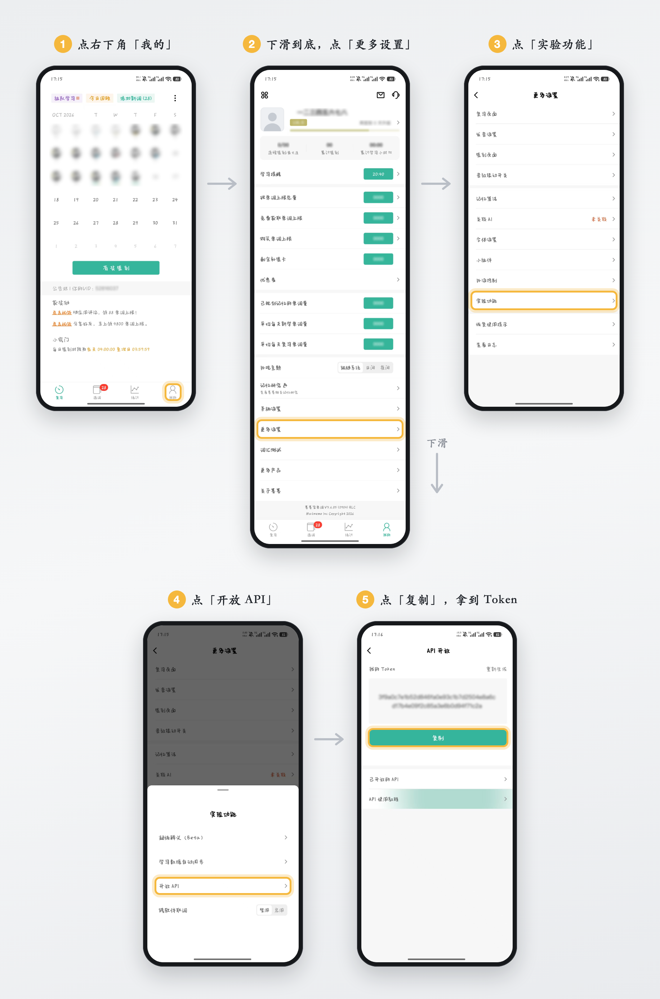
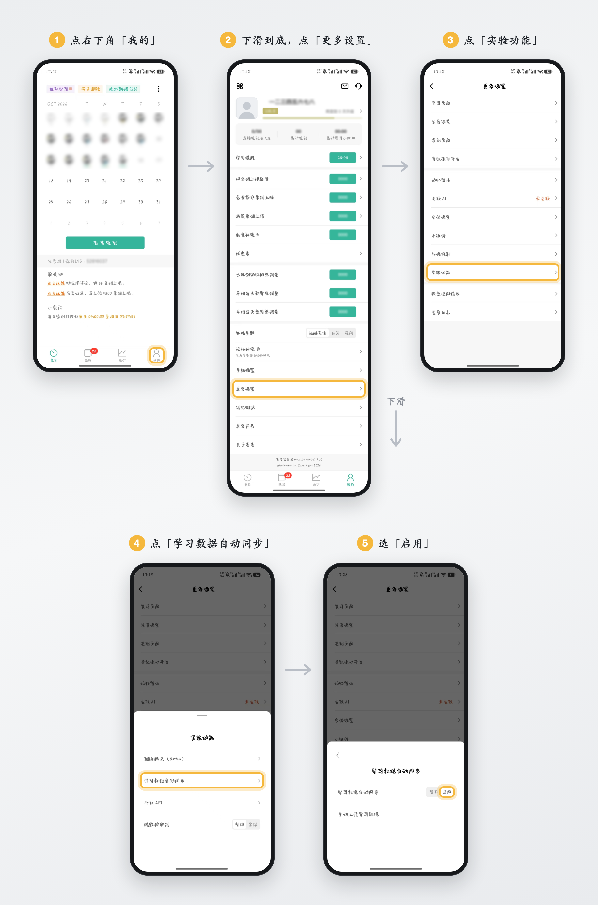
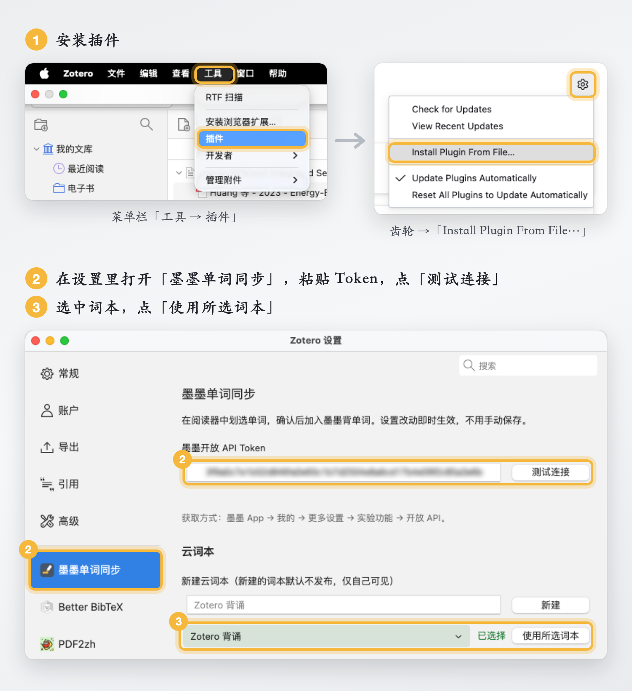

<p align="center">
  
</p>

<h1 align="center">zotero-maimemo</h1>

<p align="center">
  <a href="https://github.com/Heart-ttt/zotero-maimemo/releases">
    
  </a>
  <a href="LICENSE">
    
  </a>
  
</p>

<p align="center">
  <strong>📖 读论文背单词，从此不分家</strong><br/>
  在 Zotero 里遇到生词？只需轻轻双击，单词即刻飞入墨墨背单词并自动排入学习计划。
  
  ❌ 不用手动建注释 · ❌ 不用切回 App 添加 
  
  ✅ 云端实时同步，沉浸式阅读体验拉满！
</p>

  


<p align="center">
  <a href="https://github.com/Heart-ttt/zotero-maimemo/releases"><b>下载最新版</b></a> ·
  <a href="#界面预览">界面预览</a> ·
  <a href="#主要功能">主要功能</a> ·
  <a href="#快速开始">快速开始</a>
</p>


## 界面预览

<p align="center">半分钟看完从划词到单词出现在手机上的全过程</p>

https://github.com/user-attachments/assets/2ca14502-157b-46f4-82f2-20a9e2d03974

## 主要功能

1. **双击选词，一键加入**，单词自动进入墨墨云词本和学习计划，直接出现在手机端的复习队列。
2. **智能还原单词原形**，ablations 自动变 ablation，taught 自动变 teach，识别不准可随时手动修正。
3. **只针对英文生效**，遇到中文、标点、数字不会误弹窗。
4. **后台智能排队同步**；断网或 Token 失效先本地保存，恢复后自动补齐。
5. **支持在设置页选择或新建云词本**，同步基于词本 ID，后续改名也不影响同步。

## 快速开始

先在手机上的墨墨背单词里拿到 Token、打开学习数据自动同步，再到 Zotero 里装插件、填 Token、选词本。

### 一、手机端设置（墨墨背单词 App）

#### 1. 获取 Token

打开「我的 → 更多设置 → 实验功能 → 开放 API」，点「复制」。

> [!WARNING]
> 用 App 里的签发的token，不要用网页端签发的，网页端的 24 小时就过期，需要一直更新。
<p align="center">
  
</p>


#### 2. 开启学习数据自动同步

打开「我的 → 更多设置 → 实验功能 → 学习数据自动同步」，选「启用」。不开的话，单词加不进学习计划。

<p align="center">
  
</p>

### 二、Zotero 设置

#### 1. 安装插件

1. 从 [Releases](https://github.com/Heart-ttt/zotero-maimemo/releases) 下载 `zotero-maimemo-x.y.z.xpi`
2. Zotero 菜单「工具 → 插件」，点右上角齿轮，选「Install Plugin From File…」，选中下载的 xpi

#### 2. 填入 Token

Zotero 设置里找到「墨墨单词同步」，粘贴手机端第 1 步复制的 Token，点「测试连接」，通了会显示绿字。设置页没有保存按钮，改动即时生效。

#### 3. 选择云词本

在云词本列表里选一个，点「使用所选词本」。没有合适的，就在上面「新建云词本」里填个名字，点「新建」，新词本会自动选中，再点「使用所选词本」。

> [!NOTE]
> 具体操作流程如下图所示:

<p align="center">
  
</p>

#### 4. 开始使用

打开一篇英文 PDF，双击一个单词，在弹出的选中弹窗里确认原形，点「加入」。等墨墨 App 同步后，单词会出现在云词本和复习里。

## 使用须知

- 新加入的词默认会「提前复习」，一次加很多词时当天的复习队列会被插队
- 写云词本是整本读出再写回，同步过程中在 App 里编辑同一个词本，改动可能被覆盖
- Token 存在 Zotero 的登录管理器里，不写进普通配置文件

## 升级

按「Zotero 设置」第 1 步直接安装新版 xpi，覆盖旧版即可。不用重启，Token 和词本设置都会保留。

> [!WARNING]
> 不要先「移除」再装：移除要等关掉插件窗口才执行，新装的那份会被一起删掉。确实要移除，先关掉插件窗口，再重新安装。

## 开发

```bash
npm install
npm test        # 单元测试
npm run lint    # 代码规范检查
npm run build   # 打包到 dist/
```

main 分支受保护，改动走 PR，CI 通过才能合并。

架构说明见 [docs/ARCHITECTURE.md](docs/ARCHITECTURE.md)，功能范围和已知限制见 [docs/SCOPE.md](docs/SCOPE.md)，发布流程和 README 里视频、流程图的生成方法见 [docs/HANDOFF.md](docs/HANDOFF.md)。

## 免责声明

本项目为第三方插件，与墨墨背单词及其开发者无关，也与 Zotero 及 Corporation for Digital Scholarship 无关。

## 许可证

<p align="center">
  本项目基于 <a href="LICENSE"><b>MIT 许可证</b></a> 开源，可自由使用、修改和分发。<br/>
  <sub>© 2026 LokanXu</sub>
</p>
